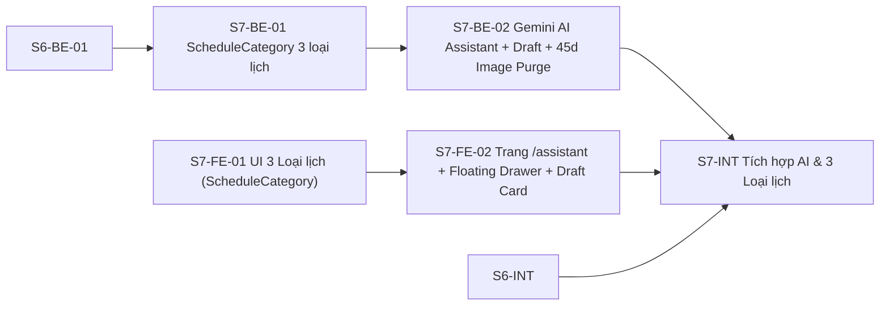

# Điều phối: ai-assistant-schedules (SPEC-007)

Vai trò, mô hình git, vòng lặp Coordinator, gate, mẫu prompt và điều kiện BLOCKED: **dùng nguyên** [`../auth-profile/ORCHESTRATION.md`](../auth-profile/ORCHESTRATION.md) §2–§5, §7–§8.

- **Spec:** [`docs/specs/SPEC-007-schedule-categories-and-ai-assistant.md`](../../docs/specs/SPEC-007-schedule-categories-and-ai-assistant.md)
- **Ticket FE:** [`./issues/`](./issues/) · **Ticket BE:** `../CuteTeachy-BE/.scratch/ai-assistant-schedules/issues/`
- **Integration branch:** `feat/ai-assistant-schedules` ở cả hai repo.

## Task graph

## Bảng trạng thái

| Ticket | Status | Branch | Ghi chú |
| --- | --- | --- | --- |
| S7-BE-01 | done | ticket/s7-be-01-schedule-categories | Đã merge 09b7cb5 |
| S7-BE-02 | in-progress | ticket/s7-be-02-ai-assistant-gemini | — |
| S7-FE-01 | done | ticket/s7-fe-01-schedule-categories-ui | Đã merge 8300056 |
| S7-FE-02 | in-progress | ticket/s7-fe-02-ai-assistant-ui | — |
| S7-INT | ready-for-agent | ticket/s7-int-ai-assistant-schedules | Blocked by S7-BE-02, S7-FE-02, S6-INT |
