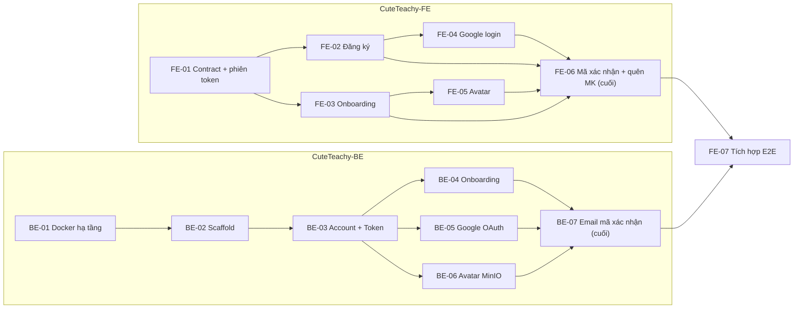

# Điều phối: auth-profile (SPEC-002)

Playbook cho **1 Coordinator + nhiều Implementer chạy song song + Merger + Reviewer** trên hai repo `CuteTeachy-BE` và `CuteTeachy-FE`. Coordinator đọc file này từ đầu đến cuối trước khi giao việc; Implementer chỉ cần đọc mục *Implementer* và ticket của mình.

**Context pointers (đọc theo nhu cầu, không copy nội dung vào prompt):**
- Spec + API contract: [`docs/specs/SPEC-002-auth-google-onboarding-avatar.md`](../../docs/specs/SPEC-002-auth-google-onboarding-avatar.md)
- Ticket FE: [`./issues/`](./issues/) · Ticket BE: `../CuteTeachy-BE/.scratch/auth-profile/issues/`
- Rule kiến trúc BE: `../CuteTeachy-BE/AGENTS.md` · ADR BE: `../CuteTeachy-BE/docs/adr/`
- Thuật ngữ: [`GLOSSARY.md`](../../GLOSSARY.md)

## 1. Task graph



FE **không** chờ BE: FE bám API contract trong SPEC-002 và chạy trên mock backend. Hai nhánh chỉ gặp nhau ở **FE-07**.

### Wave dự kiến (frontier)

| Wave | BE | FE | Song song tối đa |
| --- | --- | --- | --- |
| 1 | BE-01 | FE-01 | 2 |
| 2 | BE-02 | FE-02, FE-03 | 3 |
| 3 | BE-03 | FE-04, FE-05 | 3 |
| 4 | BE-04, BE-05, BE-06 | FE-06 *(khi FE-02..05 xong)* | 4 |
| 5 | BE-07 | — | 1 |
| 6 | FE-07 | | 1 |

Wave chỉ là dự báo; Coordinator luôn tính lại frontier thật sau mỗi lần merge.

## 2. Vai trò

| Vai trò | Được ghi | Không được ghi |
| --- | --- | --- |
| **Coordinator** | Dòng `**Status:**` của ticket, bảng trạng thái (§6), SPEC-002 (khi duyệt đổi contract), lệnh git tạo/xoá branch & worktree | Code tính năng |
| **Implementer** | Code + test trong *Vùng sở hữu* của ticket, trên branch ticket của mình | File ticket, SPEC-002, vùng của ticket khác, integration branch |
| **Merger** | Integration branch (merge, giải xung đột thuần cơ học) | Đổi hành vi khi giải xung đột — xung đột logic trả về Implementer |
| **Reviewer** | Báo cáo review | Code |

Mỗi vai trò là một subagent riêng (context riêng). Coordinator giao việc bằng **context pointer** (đường dẫn ticket, spec, commit), không dán lại nội dung.

## 3. Mô hình git

- Mỗi repo có integration branch **`feat/auth-profile`**, tách từ **branch gốc** của repo: BE = `main`, FE = `dev` (FE làm việc trên `dev`, `main` đang chậm hơn).
- Mỗi ticket: branch `ticket/<id>-<slug>` (ví dụ `ticket/be-03-account-token`) trong worktree riêng tại `d:\Code\CuteTeachy\.worktrees\<id>`.
- Implementer rebase/merge tip của integration branch vào branch mình **trước khi báo xong**.
- Chỉ Merger ghi vào `feat/auth-profile`. Branch gốc (`main` của BE, `dev` của FE) không bị đụng tới cho đến khi người dùng duyệt PR cuối.

### Bước 0 — Coordinator chuẩn bị (một lần)

1. ~~`CuteTeachy-BE` chưa là git repo~~ — **đã xong 2026-10-24**: remote `https://github.com/tranlinh642/CuteTeachy-BE`, `main` và `feat/auth-profile` đã push (commit `5eae0f1`).
2. ~~`CuteTeachy-FE`: working tree phải sạch~~ — **đã xong 2026-10-24**: đã commit `next-env.d.ts` vào `dev` và sync sang `feat/auth-profile`.
3. ~~Tạo `feat/auth-profile` ở cả hai repo~~ — **đã xong 2026-10-24** (BE từ `main`, FE từ `dev`, đều đã push).
4. Sau khi BE-02 merge: index BE bằng GitNexus (skill `gitnexus-cli`); index lại FE nếu stale.

## 4. Vòng lặp của Coordinator

```
lặp cho tới khi mọi ticket = done:
  1. Tính frontier = ticket ready-for-agent có mọi blocker = done.
  2. Lọc theo giới hạn: tối đa 3 Implementer/repo và 4 Implementer tổng cùng lúc; hai ticket trùng Vùng sở hữu không chạy cùng lúc.
  3. Với mỗi ticket được chọn: tạo branch + worktree, đặt Status = in-progress, giao Implementer (mẫu §7.2).
  4. Khi Implementer báo xong: kiểm tra báo cáo đủ bằng chứng (§5) → Status = in-review → giao Merger (mẫu §7.3).
  5. Merger xanh → Status = done, xoá worktree. Merger đỏ → Status = in-progress, trả lỗi cho Implementer cũ.
  6. Implementer báo BLOCKED → Status = blocked, xử lý (§8), không tự đoán thay.
khi tất cả done:
  7. Reviewer chạy skill `code-review` trên `feat/auth-profile` của từng repo (mẫu §7.4).
  8. Một Implementer sửa toàn bộ phát hiện của review; Merger merge.
  9. Báo người dùng: branch, danh sách ticket, kết quả gate kèm output thật.
```

## 5. Gate — điều kiện để một ticket được coi là xong

Implementer phải dán **output thật** của từng lệnh vào báo cáo:

- **BE:** type-check, lint (bao gồm `no-restricted-imports` theo layer), unit test, e2e test của ticket. Lệnh cụ thể do BE-02 ghi vào `CuteTeachy-BE/AGENTS.md`; trước BE-02 chỉ có BE-01 dùng `docker compose` để kiểm.
- **FE:** `pnpm check-types`, `pnpm lint`, `pnpm test`.
- **Cả hai:** mọi checkbox acceptance criteria trong ticket được đánh dấu kèm cách kiểm; GitNexus `detect_changes` chỉ báo file trong Vùng sở hữu (khi repo đã được index).

Merger chạy lại toàn bộ gate trên integration branch sau merge. Thiếu bằng chứng = chưa xong.

## 6. Bảng trạng thái (Coordinator cập nhật)

Vòng đời: `ready-for-agent → in-progress → in-review → done`, hoặc `blocked` (kèm lý do).

| Ticket | Status | Branch | Ghi chú |
| --- | --- | --- | --- |
| BE-01 | done | ticket/be-01-docker-dev-infra | Đã merge 778b90e |
| BE-02 | done | ticket/be-02-scaffold-nestjs-clean-architecture | Đã merge 0a451a4 |
| BE-03 | done | ticket/be-03-account-password-login-tokens | Đã merge dc54371 |
| BE-04 | done | ticket/be-04-onboarding-profile-update | Đã merge 29ec2d0 |
| BE-05 | done | ticket/be-05-google-oauth-account-linking | Đã merge 0921aed |
| BE-06 | done | ticket/be-06-avatar-upload-minio | Đã merge 7f42b9c |
| BE-07 | done | ticket/be-07-email-verification-password-reset | Đã merge e0dad46 |
| FE-01 | done | ticket/fe-01-contract-session-refresh-mock | Đã merge 6984868 |
| FE-02 | done | ticket/fe-02-register-screen | Đã merge 91e78d0 |
| FE-03 | done | ticket/fe-03-onboarding-screen-guard | Đã merge eb42f66 |
| FE-04 | done | ticket/fe-04-google-login-callback | Đã merge a983984 |
| FE-05 | done | ticket/fe-05-avatar-display-upload | Đã merge 46253af |
| FE-06 | done | ticket/fe-06-email-verification-forgot-password | Đã merge e5bc633 |
| FE-07 | in-progress | ticket/fe-07-e2e-integration-cross-repo | Wave 6 (tích hợp) |

## 7. Mẫu prompt

### 7.1 Coordinator (khởi động)

> Bạn là Coordinator cho SPEC-002. Đọc `CuteTeachy-FE/.scratch/auth-profile/ORCHESTRATION.md` và làm theo §3 Bước 0 rồi vòng lặp §4. Bạn không viết code tính năng. Mọi quyết định ngoài spec phải hỏi người dùng.

### 7.2 Implementer

> Bạn là Implementer cho ticket `<đường dẫn ticket>`, làm trong worktree `<đường dẫn>` trên branch `<branch>`.
> 1. Xác nhận branch dựa trên tip `feat/auth-profile`; nếu không, reset về đó.
> 2. Đọc ticket, các mục SPEC-002 mà ticket trỏ tới, và `AGENTS.md` của repo.
> 3. Trước khi sửa symbol đã tồn tại: skill `gitnexus-impact-analysis`. Rename/extract/move: `gitnexus-refactoring`.
> 4. Xây bằng skill `tdd`. Chỉ sửa trong *Vùng sở hữu*.
> 5. Merge tip `feat/auth-profile` vào branch, chạy gate §5, commit.
> 6. Báo cáo theo mẫu §7.5. Gặp điều kiện §8 → dừng và báo `BLOCKED`, không tự quyết.

### 7.3 Merger

> Merge `<branch ticket>` vào `feat/auth-profile` của `<repo>`. Chỉ giải xung đột cơ học (import, thứ tự khai báo, lockfile). Xung đột đổi hành vi → huỷ merge, báo lại file + đoạn xung đột. Sau merge chạy toàn bộ gate §5 và dán output.

### 7.4 Reviewer

> Chạy skill `code-review` trên `feat/auth-profile` của `<repo>`, mốc so sánh là branch gốc (`main` với BE, `dev` với FE), spec là SPEC-002 + các ticket trong `.scratch/auth-profile/issues/`. Với BE, đối chiếu thêm `AGENTS.md` và `docs/architecture/*`. Trả danh sách phát hiện theo mức độ.

### 7.5 Mẫu báo cáo của Implementer

```
Ticket: <id> — DONE | BLOCKED
Branch / commit: <branch> @ <sha>
Acceptance criteria: [x] … (cách kiểm) / [ ] … (lý do)
Gate: <lệnh> → <tóm tắt output thật>
detect_changes: <file/symbol bị ảnh hưởng>
Ngoài phạm vi phát hiện được: <ghi chú cho Coordinator, hoặc "không">
```

## 8. Khi nào Implementer phải dừng (BLOCKED)

- Cần đổi API contract, mã lỗi hoặc kiểu dữ liệu trong SPEC-002.
- Cần sửa file/khu vực thuộc Vùng sở hữu của ticket khác.
- Acceptance criteria mâu thuẫn với spec, ADR hoặc `AGENTS.md`.
- Thiếu thông tin chỉ người dùng biết (secret, OAuth client, nơi host).

Coordinator xử lý: đổi contract → cập nhật SPEC-002, thông báo mọi Implementer đang chạy ở repo kia; tranh chấp vùng → xếp tuần tự hai ticket; thiếu thông tin → hỏi người dùng.
