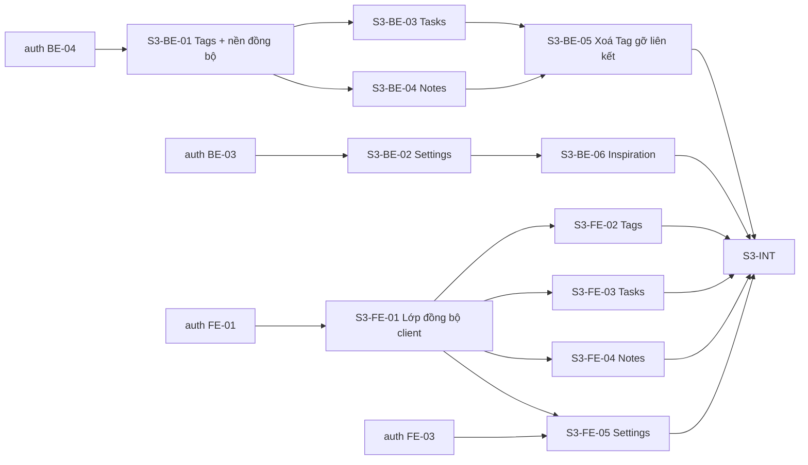

# Điều phối: content-sync (SPEC-003)

Vai trò, mô hình git, vòng lặp Coordinator, gate, mẫu prompt và điều kiện BLOCKED: **dùng nguyên** [`../auth-profile/ORCHESTRATION.md`](../auth-profile/ORCHESTRATION.md) §2–§5, §7–§8. File này chỉ ghi phần riêng của feature.

- **Spec:** [`docs/specs/SPEC-003-tasks-tags-notes-sync.md`](../../docs/specs/SPEC-003-tasks-tags-notes-sync.md)
- **Ticket FE:** [`./issues/`](./issues/) · **Ticket BE:** `../CuteTeachy-BE/.scratch/content-sync/issues/`
- **Integration branch:** `feat/content-sync` ở cả hai repo (BE từ `main`, FE từ `dev`), tạo sau khi `feat/auth-profile` đã merge về branch gốc — hoặc tách từ `feat/auth-profile` nếu cần bắt đầu sớm.

## Task graph

## Vùng dễ xung đột

- `S3-BE-01` sở hữu thành phần đồng bộ dùng chung — ticket khác chỉ dùng, cần đổi → BLOCKED.
- `S3-BE-05` mở rộng use case xoá Tag của `S3-BE-01`; chạy sau khi `S3-BE-01` đã merge.
- `S3-FE-01` sở hữu tiện ích áp envelope + hạ tầng mock đồng bộ; `S3-FE-02..05` chỉ thêm handler/màn riêng.

## Bảng trạng thái

| Ticket | Status | Branch | Ghi chú |
| --- | --- | --- | --- |
| S3-BE-01 | done | ticket/s3-be-01-tags-sync-foundation | Đã merge c6a1e69 |
| S3-BE-02 | done | ticket/s3-be-02-settings | Đã merge 75f5401 |
| S3-BE-03 | done | ticket/s3-be-03-tasks | Đã merge 91d1679 |
| S3-BE-04 | done | ticket/s3-be-04-notes | Đã merge 46df3f2 |
| S3-BE-05 | ready-for-agent | | |
| S3-BE-06 | ready-for-agent | | |
| S3-FE-01 | done | ticket/s3-fe-01-client-sync-layer | Đã merge eb7ad38 |
| S3-FE-02 | done | ticket/s3-fe-02-tags | Đã merge d80cd60 |
| S3-FE-03 | done | ticket/s3-fe-03-tasks | Đã merge 1173f97 |
| S3-FE-04 | ready-for-agent | | |
| S3-FE-05 | ready-for-agent | | |
| S3-INT | ready-for-agent | | |
