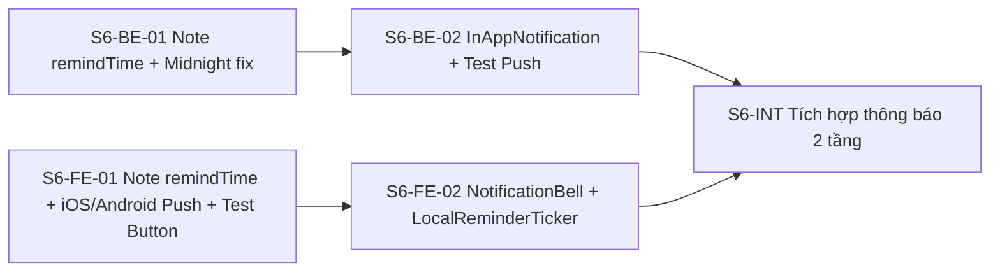

# Điều phối: dual-layer-notifications (SPEC-006)

Vai trò, mô hình git, vòng lặp Coordinator, gate, mẫu prompt và điều kiện BLOCKED: **dùng nguyên** [`../auth-profile/ORCHESTRATION.md`](../auth-profile/ORCHESTRATION.md) §2–§5, §7–§8.

- **Spec:** [`docs/specs/SPEC-006-dual-layer-notifications-and-note-reminders.md`](../../docs/specs/SPEC-006-dual-layer-notifications-and-note-reminders.md)
- **Ticket FE:** [`./issues/`](./issues/) · **Ticket BE:** `../CuteTeachy-BE/.scratch/dual-layer-notifications/issues/`
- **Integration branch:** `feat/dual-layer-notifications` ở cả hai repo.

## Task graph

## Bảng trạng thái

| Ticket | Status | Branch | Ghi chú |
| --- | --- | --- | --- |
| S6-BE-01 | ready-for-agent | ticket/s6-be-01-note-reminders-midnight | — |
| S6-BE-02 | ready-for-agent | ticket/s6-be-02-in-app-notifications | Blocked by S6-BE-01 |
| S6-FE-01 | ready-for-agent | ticket/s6-fe-01-note-remind-mobile-push | — |
| S6-FE-02 | ready-for-agent | ticket/s6-fe-02-notification-bell-ticker | Blocked by S6-FE-01 |
| S6-INT | ready-for-agent | ticket/s6-int-dual-layer-notifications | Blocked by S6-BE-02, S6-FE-02 |
