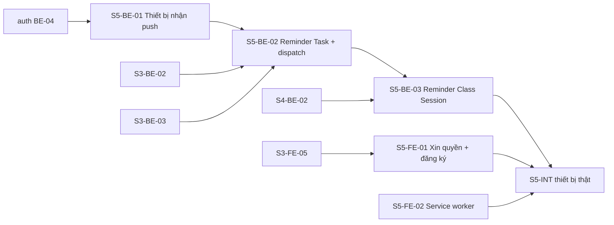

# Điều phối: push-reminders (SPEC-005)

Vai trò, mô hình git, vòng lặp Coordinator, gate, mẫu prompt và điều kiện BLOCKED: **dùng nguyên** [`../auth-profile/ORCHESTRATION.md`](../auth-profile/ORCHESTRATION.md) §2–§5, §7–§8.

- **Spec:** [`docs/specs/SPEC-005-push-reminders.md`](../../docs/specs/SPEC-005-push-reminders.md)
- **Ticket FE:** [`./issues/`](./issues/) · **Ticket BE:** `../CuteTeachy-BE/.scratch/push-reminders/issues/`
- **Integration branch:** `feat/push-reminders` ở cả hai repo.
- **Cần từ người dùng cho S5-INT production:** khoá VAPID production, `CRON_SECRET`, job cron-job.org (xem `CuteTeachy-BE/docs/setup/external-services.md` §4–§5). Thiếu thì các ticket khác vẫn làm được bằng khoá dev + `PushSender` giả.

## Task graph

`S5-FE-02` không bị chặn — có thể giao ngay từ wave đầu của bất kỳ đợt nào khi còn chỗ trống.

## Vùng dễ xung đột

- Service worker (`S5-FE-02`) dùng chung file với cache/Background Sync hiện có — chỉ thêm listener, không đổi phần cũ.
- Use case dispatch (`S5-BE-02`) gọi dọn dấu xoá mềm của `S3-BE-01` — chỉ gọi, không sửa.

## Bảng trạng thái

| Ticket | Status | Branch | Ghi chú |
| --- | --- | --- | --- |
| S5-BE-01 | in-progress | ticket/s5-be-01-push-subscriptions | Wave 1 |
| S5-BE-02 | ready-for-agent | | |
| S5-BE-03 | ready-for-agent | | |
| S5-FE-01 | in-progress | ticket/s5-fe-01-permission-subscription | Wave 1 |
| S5-FE-02 | in-progress | ticket/s5-fe-02-service-worker-push | Wave 1 (không bị chặn) |
| S5-INT | ready-for-agent | | |
