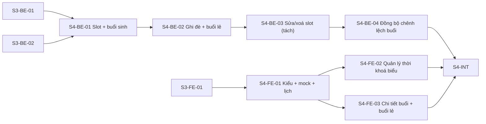

# Điều phối: timetable (SPEC-004)

Vai trò, mô hình git, vòng lặp Coordinator, gate, mẫu prompt và điều kiện BLOCKED: **dùng nguyên** [`../auth-profile/ORCHESTRATION.md`](../auth-profile/ORCHESTRATION.md) §2–§5, §7–§8.

- **Spec:** [`docs/specs/SPEC-004-timetable-class-sessions.md`](../../docs/specs/SPEC-004-timetable-class-sessions.md)
- **Ticket FE:** [`./issues/`](./issues/) · **Ticket BE:** `../CuteTeachy-BE/.scratch/timetable/issues/`
- **Integration branch:** `feat/timetable` ở cả hai repo, tách sau khi phần SPEC-003 mà nó phụ thuộc đã merge.

## Task graph

Chuỗi BE tuần tự vì cùng chạm logic sinh buổi; FE chạy song song với BE trên mock, `S4-FE-02` và `S4-FE-03` song song với nhau.

## Vùng dễ xung đột

- Domain sinh buổi/kiểm trùng (tạo ở `S4-BE-01`) được `S4-BE-02..04` và `S5-BE-03` mở rộng — luôn chạy tuần tự, không song song.
- `S4-FE-02` và `S4-FE-03` cùng thêm handler mock vào feature timetable: mỗi ticket một nhóm handler riêng; xung đột chỉ ở chỗ đăng ký route mock (cơ học).

## Bảng trạng thái

| Ticket | Status | Branch | Ghi chú |
| --- | --- | --- | --- |
| S4-BE-01 | in-progress | ticket/s4-be-01-slots-generated-sessions | Đang thực hiện wave 1 |
| S4-BE-02 | ready-for-agent | | |
| S4-BE-03 | ready-for-agent | | |
| S4-BE-04 | ready-for-agent | | |
| S4-FE-01 | in-progress | ticket/s4-fe-01-types-mock-calendar | Đang thực hiện wave 1 |
| S4-FE-02 | ready-for-agent | | |
| S4-FE-03 | ready-for-agent | | |
| S4-INT | ready-for-agent | | |
